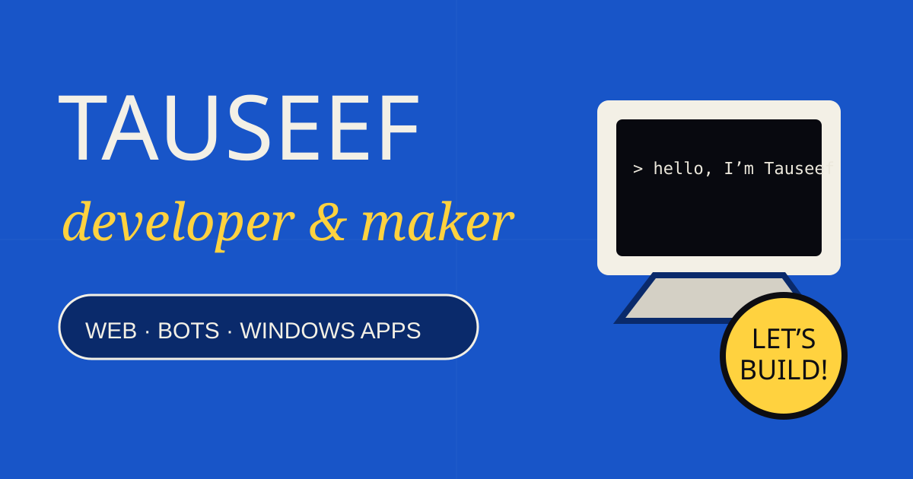

# Tauseef — Developer Portfolio



A personal portfolio built with plain HTML, CSS, and JavaScript. It keeps the original poster inspired look, with paper grain, bold type, and small motion details.

## What’s inside

- **Projects:** Yapzone, KAIRO, and CurveX, with links to their GitHub repositories.
- **Services:** Websites, Discord bots, and Windows apps.
- **About:** Background, current interests, and development journey.
- **Contact:** GitHub and Discord links.
- **Responsive layout:** Navigation and project cards adapt to smaller screens.
- **Accessibility details:** Keyboard focus styles and reduced motion support.

## Run it locally

No build tools or dependencies are required.

1. Install Python if it is not already available.
2. Open a terminal in this repository folder.
3. Start a local server:

   ```powershell
   python -m http.server 8000
   ```

4. Visit 
(https://tauseefwho.github.io/tauseef-portfolio-website/)
You can also open `index.html` directly in a browser, though a local server is better for checking the page as a website.

## Project files

| File | Purpose |
| --- | --- |
| `index.html` | Page content, links, and SEO/social metadata |
| `styles.css` | Poster design, animations, and responsive layout |
| `script.js` | Typing, reveal, and pointer animations |
| `social-preview.svg` | Social sharing artwork and this README preview |

## Contact

- [GitHub](https://github.com/tauseefwho)
- [Discord community](https://discord.gg/pRscvg2JD)

The supplied source did not include an email address, so none is listed here.
